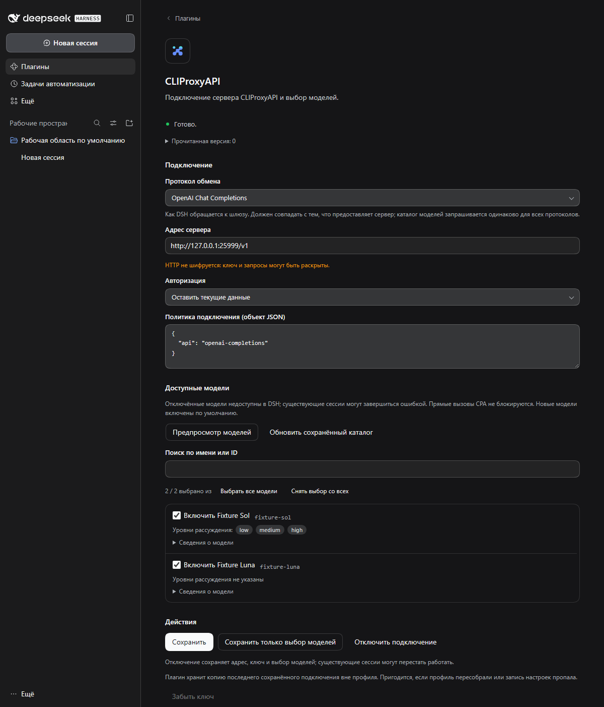

# CLIProxyAPI Provider for DeepSeek Harness

[English](./README_EN.md) | 简体中文

将一个 CLIProxyAPI 网关连接到 DeepSeek Harness。可选择通信协议——OpenAI Responses（默认）、OpenAI Chat Completions、Anthropic Messages 或 Google Generative AI——插件会原生使用该协议。保留现有会话的 `CLIProxyAPI` 和模型 ID。

## 安装与配置

插件发布在自己的 DSH 插件市场索引中。先添加一次索引，之后即可在 **插件 → 发现** 中安装和更新：

```
https://raw.githubusercontent.com/thebtf/dsh-cliproxyapi-provider/main/market/index.json
```

需要 Node.js 24.9.0 或更新版本和 DeepSeek Harness 0.2.2-rc.3（`engines.dsh` 允许 0.2.x 系列，核心小版本更新不会停用插件）。插件已发布到 npm，安装与升级就是普通安装：

```powershell
npx @deepseek-ai/dsh plugin --profile web add '@thebtf/dsh-cliproxyapi-provider@0.4.4'
npx @deepseek-ai/dsh web
```

下面的市场索引指向同一批 npm 版本；按 GitHub 标签安装仍然可用：`github:thebtf/dsh-cliproxyapi-provider#v0.4.4`。

安装或升级后重启 Web 或 Desktop。在侧边栏 **插件** 页面选择 **CLIProxyAPI**，先选择网关提供的通信协议，再填写实际地址；不会自动假定本地地址。模型目录对所有协议都从同一个 `/models` 地址读取。明确选择保留身份、替换密钥、使用凭据引用或不使用验证。HTTP 不加密，密钥和请求可能泄露；对新地址重用已有身份需要明确同意。



预览目录后可搜索、选择模型；批量操作针对全部已加载模型。保存会一起提交地址、验证操作、策略和模型草稿。允许保存零个模型，但此时原生连接不可用。暂时缺失的模型选择会保留，新模型默认启用。模型详情显示元数据、能力来源和已声明的推理等级。刷新失败时保留上次可用目录并标记过期；保存成功不代表激活成功。

插件在配置文件之外还保留一份已保存连接的副本。如果配置文件被重建、设置条目被核心版本门禁停用或包被重装导致连接消失，页面会显示 **恢复已保存的连接**，无需重新输入地址和密钥。

**停用连接**保留地址、凭据和模型选择；**忘记密钥**是单独操作，可能导致连接不可用，不会自动切换为无验证模式。直接 CPA API 调用不受影响。

## 迁移与回退

旧的通用 CLIProxyAPI 配置在插件接管前拥有原有路由。保存第一个连接时会自动接管该配置：插件记录完整备份、移除旧条目，并在首次目录刷新成功后完成切换。也可在 CPA 页面显式选择 **导入旧连接**。所有权不明确、缺少地址或字段无法迁移时会给出提示，不会静默覆盖。切换时可能短暂中断。不要用旧备份覆盖较新设置；只有迁移恢复／回退的所有权与版本检查允许时才能回退，否则应向前修复。升级前保留备份，更换版本后重启。

## Models 集成范围

Models 页底部显示 CPA 状态和 **打开插件**。点击后再选择 **CLIProxyAPI** 进入设置。这不是 Models 主列表中的完整自主管理行；其中原生编辑／删除操作不是 CPA 生命周期操作。

`latest` 通道需要支持 GitHub 的更新器。市场索引为每个版本固定了一个确切提交，因此通过索引安装后市场有了可比较、可更新的稳定来源。npm 发布已接入 GitHub Releases（见 `.github/workflows/publish.yml`）；原生 Versions 只更新 registry 安装；npm 发布使用 npm trusted publishing（OIDC）认证，仓库中不保存任何令牌，首次配置见 [RELEASING.md](RELEASING.md)。卸载命令：`npx @deepseek-ai/dsh plugin --profile web remove @thebtf/dsh-cliproxyapi-provider`，然后重启；卸载不承诺删除已保存配置。