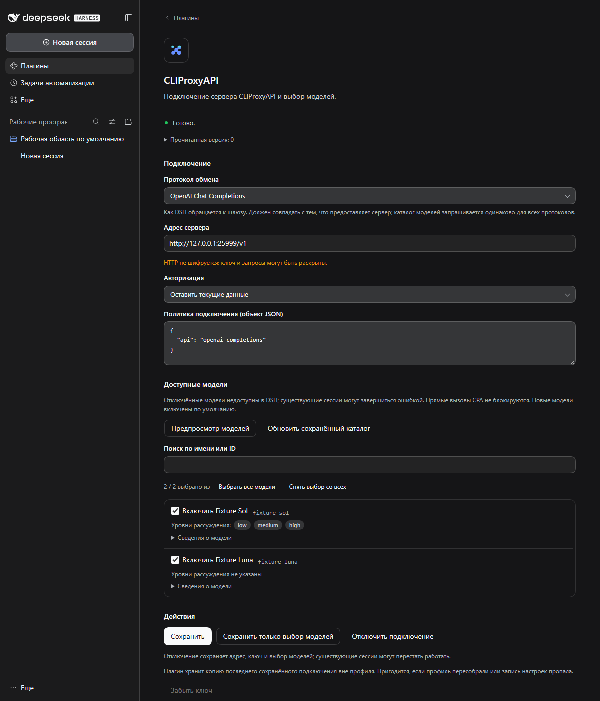

# CLIProxyAPI Provider for DeepSeek Harness

[English](https://github.com/thebtf/dsh-cliproxyapi-provider#readme) · [Русский](https://github.com/thebtf/dsh-cliproxyapi-provider/blob/main/README_RU.md) · [简体中文](https://github.com/thebtf/dsh-cliproxyapi-provider/blob/main/README_ZH.md)

Connect an existing [CLIProxyAPI](https://github.com/router-for-me/CLIProxyAPI) gateway to DeepSeek Harness (DSH). Manage the connection, enabled models, and per-model token limits from the **CLIProxyAPI** plugin page. This plugin does not run a gateway for you.

## Install or update

**From DSH:** Enable **Custom plugin indexes** if the **Discover** tab is missing. In **Plugins → Discover**, add this index and install **CLIProxyAPI**:

```text
https://raw.githubusercontent.com/thebtf/dsh-cliproxyapi-provider/main/market/index.json
```

**From the CLI:** Use the `dsh` CLI for your DSH installation. Replace `web` with the active profile name (for example, `desktop` in Desktop).

```sh
dsh plugin --profile web add '@thebtf/dsh-cliproxyapi-provider@latest'
```

For rollback or a reproducible setup, replace `@latest` with a verified version such as `@0.5.6`. Rolling back the package does not undo settings migrations.

Restart DSH after installing or updating. See [npm](https://www.npmjs.com/package/@thebtf/dsh-cliproxyapi-provider) for published versions and [GitHub Releases](https://github.com/thebtf/dsh-cliproxyapi-provider/releases) for release notes and recovery archives.

## Connect your gateway

1. Open **Plugins → CLIProxyAPI**. Select the protocol your gateway serves: **OpenAI Responses** (default), **OpenAI Chat Completions**, **Anthropic Messages**, or **Google Generative AI**.
2. Enter the gateway URL and choose an authentication mode: keep the saved identity, enter a new key, use a credential reference, or explicitly use no authentication. Use HTTPS for remote gateways. A trailing `/v1` is optional; the catalog is read from `/v1/models`.
3. Preview the catalog, select the models you want, and choose **Save**. Check that the connection reports **Ready**, then select a CLIProxyAPI model in DSH. Saving settings alone does not confirm activation.

The model cards show context window and maximum output overrides. Use **Save model settings** to apply them. Clear either field to use the gateway value, or the plugin default if the gateway omits it. These settings cannot increase the upstream model’s actual capacity.



*Earlier version of the settings page, shown in Russian.*

## Model catalog

Enabled models appear first when you open the list. Rows stay in place while you edit and save; the new order is applied the next time you open the list. Bulk controls affect the entire loaded catalog, not just search results. Selections for temporarily absent models are retained, and new models start enabled. A failed refresh keeps the last good catalog and marks it stale. Saving with no models enabled leaves the provider unavailable in DSH, but does not affect direct calls to CPA.

## Compatibility

| DSH core | Builds tested in CI |
| --- | --- |
| 0.2.2, starting at rc.3 | `0.2.2-rc.3` (official Desktop), `0.2.2-rc.5` (Desktop NEXT core) |
| 0.2.3, starting at alpha.2 | `0.2.3-alpha.2` (Desktop Beta core) |

The [CI matrix](https://github.com/thebtf/dsh-cliproxyapi-provider/actions/workflows/compatibility.yml) checks the core APIs and installs the packed plugin. It does not certify an entire Desktop distribution. The plugin requires Node.js **24.9.0+**; use a newer version if your DSH host requires it.

## Existing installations

- **Existing CLIProxyAPI model connection:** Back up your settings before moving it. Choose **Import legacy connection**, or save the first connection to adopt an eligible legacy entry. The plugin preserves the `CLIProxyAPI` provider ID; keep model IDs unchanged for existing sessions.
- **Installed from Git or a local file:** If the package already uses the npm name above, back up the profile and credentials, then install the verified npm version into the same profile without uninstalling first. Restart and check the connection. An older package name needs a separate migration; do not install a second provider and assume ownership transfers.
- **Connection missing after a profile rebuild:** Use **Restore saved connection** when offered. **Disable connection** keeps settings; **Forget key** removes the saved key and does not switch to keyless mode.

### Before switching or rolling back

Stop active requests and back up the profile, credential storage, and the plugin’s saved connection. Keep the backup private and record the previous install source and provider/model IDs. A legacy connection can briefly go offline during the handoff; the cutover completes after the first successful catalog refresh. If ownership is ambiguous or the legacy entry cannot be migrated, resolve the reported problem before retrying. After a package-source change, verify that only one copy is active, then check the connection, selected models, and an existing session. Do not restore an older backup over newer settings.

The **Models** page links back to Plugins; manage the CPA connection in the plugin page. See the [release and recovery guide](https://github.com/thebtf/dsh-cliproxyapi-provider/blob/main/RELEASING.md) for maintainer instructions.

## Uninstall

Run the following in the same profile and restart DSH. Uninstalling does not guarantee that saved configuration is deleted.

```sh
dsh plugin --profile web remove @thebtf/dsh-cliproxyapi-provider
```
