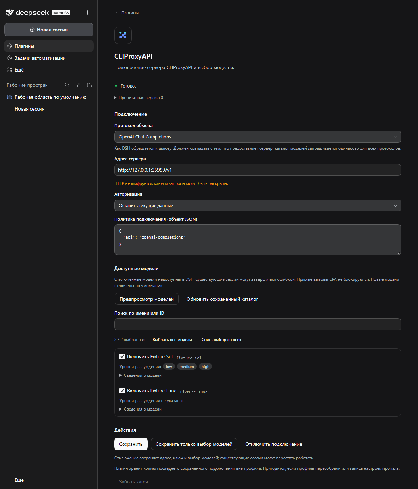

# CLIProxyAPI Provider for DeepSeek Harness

English | [简体中文](./README.md)

The plugin connects one CLIProxyAPI gateway to DeepSeek Harness. You choose the wire protocol — OpenAI Responses (default), OpenAI Chat Completions, Anthropic Messages or Google Generative AI — and the plugin speaks it natively. Existing sessions retain their `CLIProxyAPI` provider and model IDs.

## Install and configure

The plugin is listed in its own DSH plugin market index. Add the index once, then install and update from **Plugins → Discover**:

```
https://raw.githubusercontent.com/thebtf/dsh-cliproxyapi-provider/main/market/index.json
```

Requires Node.js 24.9.0 or newer. Built against DeepSeek Harness 0.2.2-rc.3; `engines.dsh` permits `>=0.2.2-rc.3 <1.0.0` to avoid unnecessary version gating, but future core API compatibility still requires testing. Install and update through npm:

```powershell
npx @deepseek-ai/dsh plugin --profile web add '@thebtf/dsh-cliproxyapi-provider@0.5.4'
npx @deepseek-ai/dsh web
```

The market index points to npm releases. Historical Git references remain available, but new installations should use npm; switching an existing installation is an explicit operation described below.

Restart the Web process or Desktop after installation or upgrade. On the sidebar **Plugins** page, choose **CLIProxyAPI**. Pick the wire protocol your gateway exposes, then enter the server address; no local address is assumed. A trailing `/v1` is optional — both spellings work, because the plugin reads the catalog from `{root}/v1/models` and gives each protocol the base its own SDK expects (nothing, `/v1` or `/v1beta`). Choose whether to keep the existing credential, replace it, use a reference, or explicitly use no authentication. HTTP is unencrypted: keys and request contents can be exposed. Reusing an existing identity with a changed endpoint requires explicit consent.



Preview the catalog, search, and select models; bulk controls affect the whole loaded catalog. Save commits the address, authentication action, policy, and model draft together. Saving zero models is allowed but leaves the native route unavailable. Absent model choices are retained and newly discovered models default to enabled. Metadata, capability sources and reported reasoning efforts are available in model details. A failed refresh preserves the last good catalog as stale. A saved configuration is not proof of successful activation.

For a model with missing or incorrect token limits, enter the context window or maximum output under **Token limits** in the model card, then choose **Save model settings**. Clear either field to use the gateway value (or the plugin default if it is missing). These limits configure the DSH client; they cannot increase what the upstream model actually supports.

The plugin also keeps a copy of the last saved connection outside the profile. If a profile rebuild, a core compatibility gate, or a reinstall removes the settings entry, the page offers **Restore saved connection**, so the address and credential do not have to be entered again.

**Disable connection** retains the address, credential and model selection. **Forget key** is a separate action and can make the connection unavailable; it does not enable keyless authentication. Direct CPA API calls are unaffected.

## Migration and rollback

An existing generic CLIProxyAPI profile owns its route until the plugin takes it over. Saving the first connection adopts that profile automatically: the plugin records a full backup, removes the legacy entry and finishes the cutover on the first successful catalog refresh. **Import legacy connection** remains available for an explicit import. Ambiguous ownership, missing addresses, and unsupported fields are reported instead of silently replaced. A brief interruption during cutover is possible. Do not restore an old backup over newer settings: use the migration recovery/rollback path only when its ownership and revision checks permit it, or repair forward. Keep a backup before upgrading and restart after changing versions.

### Switching a Git or local-file installation to npm

This is a package-source change, distinct from importing a legacy model connection.
Before changing the source, stop active requests and back up the profile plus its
credential storage and the plugin's saved-connection backup. Keep backups private.
Record the old install spec and the selected provider/model IDs.

For an installation already named `@thebtf/dsh-cliproxyapi-provider`, use the
normal npm install command above with the same profile and an explicit verified
version. Do not uninstall first or delete configuration. Restart DSH, check that
there is one active copy, verify the source/version, address, authentication and
model selections, then test an existing session. Package rollback alone does not
undo settings migrations; do not overwrite newer data blindly.

An installation under an older package name needs a separately checked migration:
do not install a second provider alongside it and assume ownership will transfer.
An isolated Desktop CLI/pnpm check passed for same-name file and commit-pinned
local-Git dependencies replaced by npm without uninstalling: sentinel settings,
profile patch files and profile configuration stayed unchanged. This was a plain
package fixture, not a full CLIProxyAPI bundle migration; activation, credentials,
existing sessions, remote Git and old package names still require separate checks.
The plugin never switches your source automatically.

## Models integration

The Models footer shows CPA status and **Open Plugins**. Open Plugins, then select **CLIProxyAPI** to reach its settings. This is not a complete owner-controlled row in the main Models provider list; native Edit/Delete there are not CPA lifecycle actions.

npm is the normal installation and update source. GitHub Releases provide release notes and a manual recovery tarball, not a separate updater. The Discover index advertises verified npm versions. Recovery assets must match the npm artifact byte for byte; dependencies still need to be available. See [RELEASING.md](RELEASING.md) for publication and recovery details. Uninstall with `npx @deepseek-ai/dsh plugin --profile web remove @thebtf/dsh-cliproxyapi-provider` and restart; uninstall does not promise deletion of saved configuration.