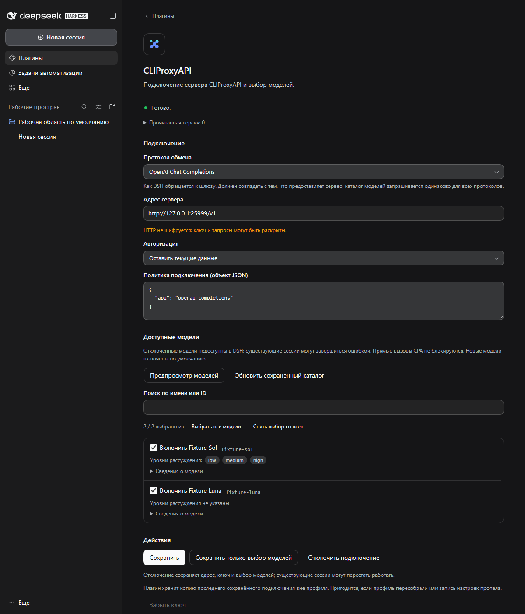

# Провайдер CLIProxyAPI для DeepSeek Harness

[English](https://github.com/thebtf/dsh-cliproxyapi-provider#readme) · [Русский](https://github.com/thebtf/dsh-cliproxyapi-provider/blob/main/README_RU.md) · [简体中文](https://github.com/thebtf/dsh-cliproxyapi-provider/blob/main/README_ZH.md)

Плагин подключает существующий шлюз [CLIProxyAPI](https://github.com/router-for-me/CLIProxyAPI) к DeepSeek Harness (DSH). Подключение, выбор моделей и их лимиты настраиваются на странице плагина **CLIProxyAPI**. Сам шлюз плагин не запускает.

## Установка и обновление

В DSH откройте **Плагины → Откройте для себя**, добавьте индекс и установите **CLIProxyAPI**. Если вкладки нет, включите экспериментальный плагин **Пользовательские индексы плагинов**.

```text
https://raw.githubusercontent.com/thebtf/dsh-cliproxyapi-provider/main/market/index.json
```

Или воспользуйтесь CLI вашей установки DSH. Вместо `web` укажите активный профиль, например `desktop` для Desktop:

```sh
dsh plugin --profile web add '@thebtf/dsh-cliproxyapi-provider@latest'
```

Для отката или воспроизводимой установки замените `@latest` на проверенную версию, например `@0.5.6`. Откат пакета не отменяет миграцию настроек.

После установки или обновления перезапустите DSH. Версии доступны в [npm](https://www.npmjs.com/package/@thebtf/dsh-cliproxyapi-provider), а примечания и резервные архивы — в [GitHub Releases](https://github.com/thebtf/dsh-cliproxyapi-provider/releases).

## Настройка подключения

1. Откройте **Плагины → CLIProxyAPI** и выберите протокол шлюза: **OpenAI Responses** (по умолчанию), **OpenAI Chat Completions**, **Anthropic Messages** или **Google Generative AI**.
2. Введите адрес и выберите способ авторизации: сохранить текущие данные, заменить ключ, указать ссылку на учётные данные или явно отключить авторизацию. Для удалённого шлюза используйте HTTPS. Суффикс `/v1` необязателен; каталог читается из `/v1/models`.
3. Загрузите предпросмотр каталога, отметьте модели и нажмите **Сохранить**. Дождитесь статуса **Готово**, затем выберите модель CLIProxyAPI в DSH. Само сохранение не означает, что подключение активно.

Окно контекста и максимальный вывод можно переопределить в карточке модели и применить кнопкой **Сохранить настройки моделей**. Пустое поле возвращает значение шлюза, а при его отсутствии — значение по умолчанию. Это не увеличивает реальные возможности модели.



*Предыдущая версия страницы настроек.*

## Каталог моделей

При открытии списка включённые модели идут первыми. Строки не перемещаются при редактировании и сохранении: новый порядок применяется при следующем открытии. Массовые действия охватывают весь загруженный каталог, а не только результаты поиска. Выбор временно отсутствующих моделей сохраняется, новые модели включены по умолчанию. При сбое обновления последняя рабочая копия каталога сохраняется и отмечается как устаревшая. Если отключить все модели, провайдер станет недоступен в DSH, но прямые вызовы CPA продолжат работать.

## Совместимость

| Ядро DSH | Проверено в CI |
| --- | --- |
| 0.2.2 начиная с rc.3 | `0.2.2-rc.3` (официальный Desktop), `0.2.2-rc.5` (ядро Desktop NEXT) |
| 0.2.3 начиная с alpha.2 | `0.2.3-alpha.2` (ядро Desktop Beta) |

[Матрица CI](https://github.com/thebtf/dsh-cliproxyapi-provider/actions/workflows/compatibility.yml) проверяет API ядра и установку упакованного плагина, а не работу всей сборки Desktop. Плагину нужен Node.js **24.9.0+**; если DSH требует более новую версию, используйте её.

## Для существующих установок

- **Старое подключение CLIProxyAPI:** Сделайте резервную копию настроек. Выберите **Импортировать старое подключение** или сохраните первое подключение для переноса подходящей старой записи. Для существующих сессий сохраняйте исходные ID моделей.
- **Установка из Git или файла:** Если имя пакета уже совпадает с указанным выше, сохраните резервную копию профиля и учётных данных, затем установите проверенную версию из npm в тот же профиль без предварительного удаления. Перезапустите DSH и проверьте подключение. Для старого имени пакета нужна отдельная миграция.
- **Подключение пропало после пересоздания профиля:** Если доступно, выберите **Восстановить сохранённое подключение**. Отключение подключения сохраняет настройки; удаление ключа не включает режим без авторизации.

### Перед сменой источника или откатом

Остановите активные запросы и сделайте закрытую резервную копию профиля, хранилища учётных данных и сохранённого подключения плагина. Запишите прежний источник установки и ID провайдера и моделей. При переносе старого подключения возможен короткий перерыв: переход завершается после первого успешного обновления каталога. Если неясно, кому принадлежит подключение, или запись не удаётся перенести, устраните указанную ошибку перед повтором. После смены источника проверьте, что активна одна копия плагина, а затем проверьте подключение, выбранные модели и существующую сессию. Не восстанавливайте старую копию поверх более новых настроек.

Страница **Models** ведёт обратно к списку плагинов. Подключение управляется на странице **CLIProxyAPI**. Инструкции для сопровождающих — в [руководстве по релизам](https://github.com/thebtf/dsh-cliproxyapi-provider/blob/main/RELEASING.md).

## Удаление

Выполните команду в том же профиле и перезапустите DSH. Удаление плагина не гарантирует удаления сохранённых настроек.

```sh
dsh plugin --profile web remove @thebtf/dsh-cliproxyapi-provider
```
