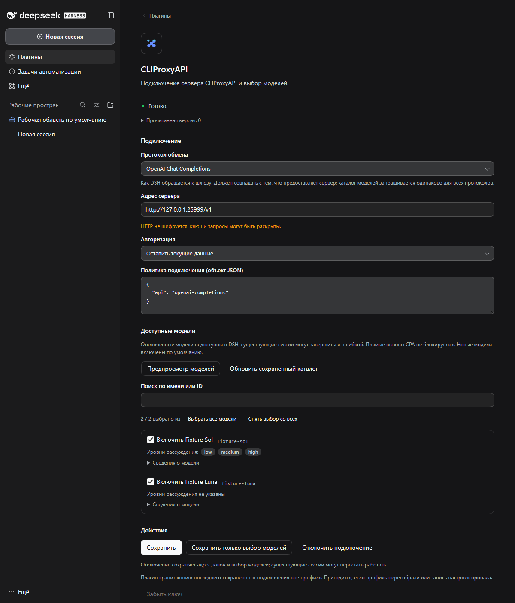

# DeepSeek Harness 的 CLIProxyAPI 提供方插件

[English](https://github.com/thebtf/dsh-cliproxyapi-provider#readme) · [Русский](https://github.com/thebtf/dsh-cliproxyapi-provider/blob/main/README_RU.md) · [简体中文](https://github.com/thebtf/dsh-cliproxyapi-provider/blob/main/README_ZH.md)

将已有的 [CLIProxyAPI](https://github.com/router-for-me/CLIProxyAPI) 网关连接到 DeepSeek Harness（DSH）。通过 **CLIProxyAPI** 插件页面管理连接、启用的模型和每个模型的令牌限制。本插件不会启动网关。

## 安装与更新

在 DSH 中打开 **插件 → 发现**，添加以下索引并安装 **CLIProxyAPI**。如果没有「发现」标签，请启用实验性插件「自定义插件索引」。

```text
https://raw.githubusercontent.com/thebtf/dsh-cliproxyapi-provider/main/market/index.json
```

也可以使用当前安装的 DSH CLI。将 `web` 替换为实际使用的配置档名称，例如桌面端的 `desktop`：

```sh
dsh plugin --profile web add '@thebtf/dsh-cliproxyapi-provider@latest'
```

如需回退或可复现的安装，请将 `@latest` 替换为已验证的版本，例如 `@0.5.6`。回退插件包不会撤销设置迁移。

安装或更新后请重启 DSH。发布版本可在 [npm](https://www.npmjs.com/package/@thebtf/dsh-cliproxyapi-provider) 查看，发行说明和恢复包位于 [GitHub Releases](https://github.com/thebtf/dsh-cliproxyapi-provider/releases)。

## 连接网关

1. 打开 **插件 → CLIProxyAPI**，选择网关支持的协议：**OpenAI Responses**（默认）、**OpenAI Chat Completions**、**Anthropic Messages** 或 **Google Generative AI**。
2. 输入网关地址并选择验证方式：保留已保存的身份、输入新密钥、使用凭据引用，或明确选择无验证。连接远程网关时请使用 HTTPS。地址末尾的 `/v1` 可省略，模型目录始终从 `/v1/models` 获取。
3. 预览目录、选择所需模型，然后点击 **保存**。确认连接状态为「就绪」后，在 DSH 中选择 CLIProxyAPI 模型。保存成功不代表连接已激活。

在模型卡片中可覆盖上下文窗口和最大输出，点击 **保存模型设置** 应用。清空字段会恢复网关值；网关未提供时使用插件默认值。这些设置不会增加上游模型的实际容量。



*旧版设置页面（俄语界面）。*

## 模型目录

打开列表时，已启用的模型显示在最前面。编辑和保存时条目不会移动；下次打开列表时才重新排序。批量操作作用于整个已加载目录，而不只是搜索结果。暂时缺失的模型仍保留原有选择，新模型默认启用。刷新失败时会保留上次可用目录并标记为过期。关闭所有模型会使该提供方在 DSH 中不可用，但不影响直接调用 CPA。

## 兼容性

| DSH 核心版本 | CI 验证版本 |
| --- | --- |
| 0.2.2，从 rc.3 开始 | `0.2.2-rc.3`（官方 Desktop）、`0.2.2-rc.5`（Desktop NEXT 核心） |
| 0.2.3，从 alpha.2 开始 | `0.2.3-alpha.2`（Desktop Beta 核心） |

[CI 矩阵](https://github.com/thebtf/dsh-cliproxyapi-provider/actions/workflows/compatibility.yml) 验证核心 API 和插件包安装，不代表整套桌面应用已通过测试。插件需要 Node.js **24.9.0+**；若 DSH 要求更新版本，请以 DSH 的要求为准。

## 已有安装

- **旧版 CLIProxyAPI 连接：** 先备份设置，然后选择 **导入旧连接**；也可保存第一个连接以接管符合条件的旧条目。保留原有模型 ID，以便继续使用已有会话。
- **从 Git 或文件安装：** 若包名已与上方命令一致，备份配置档和凭据后，可直接在同一配置档安装已验证的 npm 版本，无需先卸载。重启后检查连接。旧包名需要单独迁移。
- **重建配置档后连接消失：** 若页面提供 **恢复已保存的连接**，可用它恢复。停用连接会保留设置；忘记密钥不会切换到无验证模式。

### 切换来源或回退前

停止正在运行的请求，备份配置档、凭据存储和插件保存的连接，并妥善保管备份。记下原安装来源及提供方和模型 ID。迁移旧连接时可能短暂中断，首次成功刷新目录后完成切换。如果连接归属不明确或旧条目无法迁移，请先解决提示的问题。切换安装来源后，确认只有一个插件副本处于启用状态，再检查连接、已选模型和已有会话。不要用旧备份覆盖较新的设置。

**Models** 页面仅提供入口，连接设置仍在 **CLIProxyAPI** 插件页面管理。维护与恢复流程见[发布指南](https://github.com/thebtf/dsh-cliproxyapi-provider/blob/main/RELEASING.md)。

## 卸载

在同一配置档中执行以下命令，然后重启 DSH。卸载不保证删除已保存的配置。

```sh
dsh plugin --profile web remove @thebtf/dsh-cliproxyapi-provider
```
